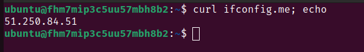
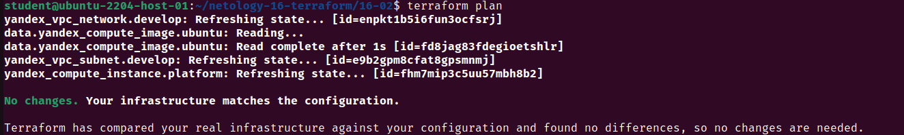
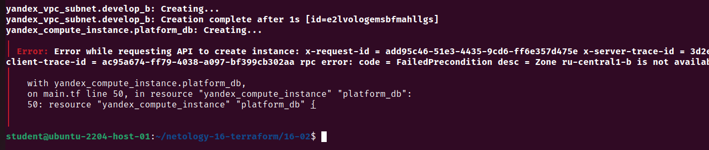

# Домашнее задание 16-02. Основы Terraform. Yandex Cloud

## Задание 1

1. Создал сервисный аккаунт `terraform-new` в Yandex Cloud и авторизованный ключ для Terraform.

2. Создал SSH-ключ и добавил публичную часть в `variables.tf`.

3. Исправил ошибки в `main.tf`:
   - `standart-v4` заменил на `standard-v2` — ошибка в названии платформы.
   - `cores = 1` заменил на `cores = 2` — для этой конфигурации нужно минимум 2 ядра.

4. Выполнил `terraform init`, `terraform validate`, `terraform plan` и `terraform apply`.

   Созданы сеть, подсеть и ВМ `netology-develop-platform-web`.

   

5. Подключился к ВМ по SSH и выполнил `curl ifconfig.me`.

   Получил IP `51.250.84.51`. Он совпадает с внешним IP в Yandex Cloud.

   

6. Ответы на вопросы:

   - `preemptible = true` — прерываемая ВМ. Она дешевле обычной, но облако может её остановить. Для учебных задач поможет сохранить бюджет.
   - `core_fraction = 5` — ВМ получает гарантированно 5% производительности каждого ядра. Для небольших учебных задач этого должно быть достаточно. Также хорошо с точки зрения экономии средств.

## Задание 2

1. Заменил значения в `main.tf` на переменные с префиксом `vm_web_`.

2. Добавил переменные в `variables.tf`, указал типы и значения `default`.

3. Выполнил `terraform fmt` и `terraform plan`.

   Результат: `No changes`. Конфигурация ВМ не изменилась.

   

## Задание 3

1. Перенёс переменные первой ВМ из `variables.tf` в `vms_platform.tf`.

2. Добавил переменные для второй ВМ `netology-develop-platform-db`.

3. Создал вторую подсеть и ВМ через `terraform apply`.

4. Первоначально использовал зону `ru-central1-b`, как указано в задании. Но Yandex Cloud вернул мне ошибку `Zone ru-central1-b is not available`. Поэтому изменил зону второй ВМ и подсети на `ru-central1-d`.

   

5. Повторно выполнил `terraform apply`. Вторая ВМ успешно создана. Обе машины работают, что подтверждается скриншотом.

   
