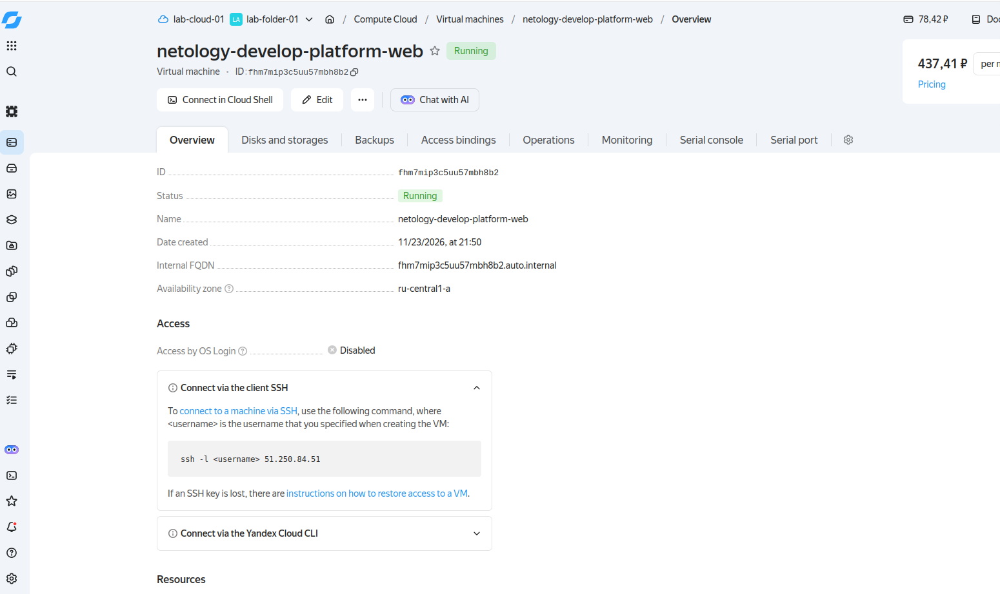
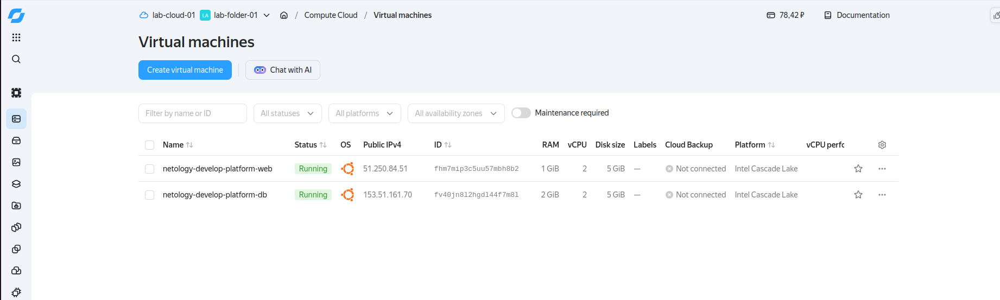
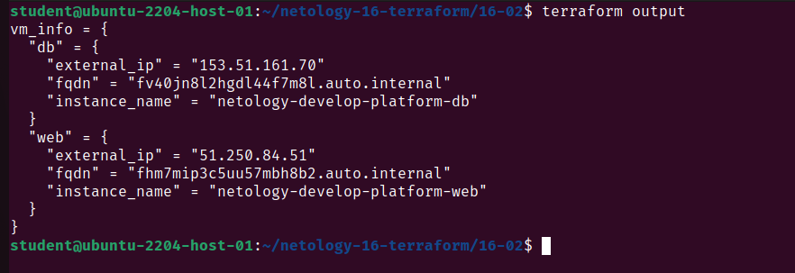
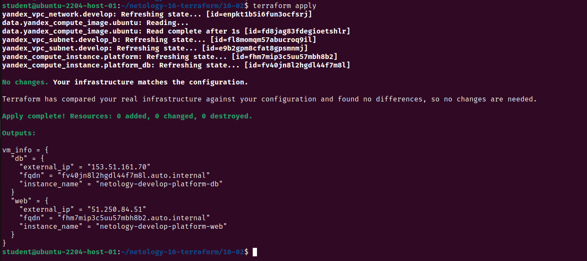
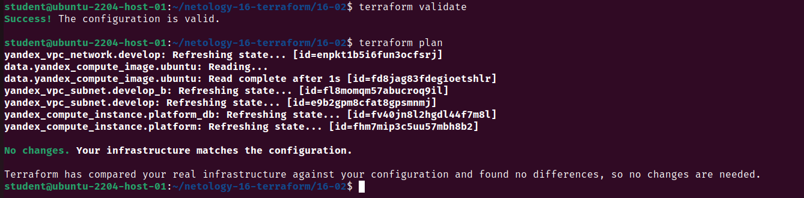
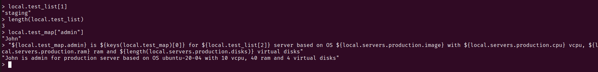
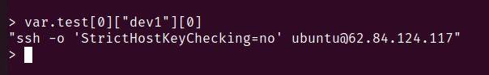
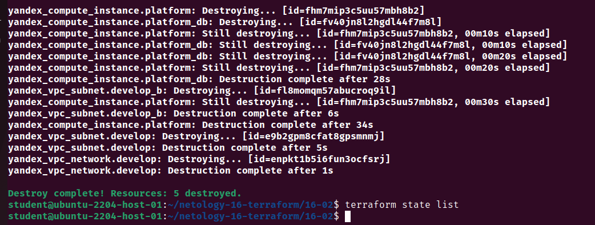

# Домашнее задание 16-02. Основы Terraform. Yandex Cloud

## Задание 1

1. Создал сервисный аккаунт `terraform-new` в Yandex Cloud и авторизованный ключ для Terraform.

2. Создал SSH-ключ и добавил публичную часть в `variables.tf`.

3. Исправил ошибки в `main.tf`:
   - `standart-v4` заменил на `standard-v2` — ошибка в названии платформы.
   - `cores = 1` заменил на `cores = 2` — для этой конфигурации нужно минимум 2 ядра.

4. Выполнил `terraform init`, `terraform validate`, `terraform plan` и `terraform apply`.

   Созданы сеть, подсеть и ВМ `netology-develop-platform-web`.

   

5. Подключился к ВМ по SSH и выполнил `curl ifconfig.me`.

   Получил IP `51.250.84.51`. Он совпадает с внешним IP в Yandex Cloud.

   

6. Ответы на вопросы:

   - `preemptible = true` — прерываемая ВМ. Она дешевле обычной, но облако может её остановить. Для учебных задач поможет сохранить бюджет.
   - `core_fraction = 5` — ВМ получает гарантированно 5% производительности каждого ядра. Для небольших учебных задач этого должно быть достаточно. Также хорошо с точки зрения экономии средств.

## Задание 2

1. Заменил значения в `main.tf` на переменные с префиксом `vm_web_`.

2. Добавил переменные в `variables.tf`, указал типы и значения `default`.

3. Выполнил `terraform fmt` и `terraform plan`.

   Результат: `No changes`. Конфигурация ВМ не изменилась.

   

## Задание 3

1. Перенёс переменные первой ВМ из `variables.tf` в `vms_platform.tf`.

2. Добавил переменные для второй ВМ `netology-develop-platform-db`.

3. Создал вторую подсеть и ВМ через `terraform apply`.

4. Первоначально использовал зону `ru-central1-b`, как указано в задании. Но Yandex Cloud вернул мне ошибку `Zone ru-central1-b is not available`. Поэтому изменил зону второй ВМ и подсети на `ru-central1-d`.

   

5. Повторно выполнил `terraform apply`. Вторая ВМ успешно создана. Обе машины работают, что подтверждается скриншотом.

   

## Задание 4

1. Создал в `outputs.tf` один output `vm_info` для вывода информации о двух ВМ.

2. Выполнил `terraform apply`. Конфигурация ВМ не поменялась.

3. Команда `terraform output` вывела имена, внешние IP и FQDN обеих машин.

   

## Задание 5

1. Добавил переменные для формирования имён ВМ в файл `vms_platform.tf`.

2. В файле `locals.tf` создал один блок `locals` с именами двух ВМ, используя `${...}`.

3. В `main.tf` заменил имена ВМ на `local.vm_web_name` и `local.vm_db_name`.

4. Выполнил `terraform plan` и `terraform apply`. Изменений нет, обе ВМ остались без изменений.

   

## Задание 6

1. Объединил параметры процессора и памяти обеих ВМ в одну переменную `vms_resources` типа `map(object)`.

2. Создал общую переменную `metadata` для обеих машин.

3. Заменил старые переменные в `main.tf` на новые.

4. Закомментировал переменные, которые больше не используются.

5. Выполнил `terraform validate` и `terraform plan`. Ошибок нет, изменений в инфраструктуре нет.

   

## Задание 7*

В `terraform console` выполнил четыре задания:

1. Второй элемент списка: `local.test_list[1]` — `"staging"`.
2. Длина списка: `length(local.test_list)` — `3`.
3. Значение ключа admin: `local.test_map["admin"]` — `"John"`.
4. Составил строку с помощью переменных из `console.tf` и функции `length()`.
   Выражение: `${local.test_map.admin} is ${keys(local.test_map)[0]} for ${local.test_list[2]} server based on OS ${local.servers.production.image} with ${local.servers.production.cpu} vcpu, ${local.servers.production.ram} ram and ${length(local.servers.production.disks)} virtual disks`

   Результат: `John is admin for production server based on OS ubuntu-20-04 with 10 vcpu, 40 ram and 4 virtual disks`.

   

## Задание 8*

1. Создал переменную `test` в `variables.tf` с типом `list(map(list(string)))`.
2. Добавил значения переменной в `terraform.tfvars` согласно заданию. Создал копию `terraform.tfvars.example` для GitHub, так как `terraform.tfvars` исключён через `.gitignore`.
3. Проверил получение SSH-команды через `terraform console`:

   `var.test[0]["dev1"][0]`

   Результат: `ssh -o 'StrictHostKeyChecking=no' ubuntu@62.84.124.117`.

   

## Удаление ресурсов

После выполнения заданий удалил созданные ресурсы командой `terraform destroy`.

Результат: `Destroy complete! Resources: 5 destroyed.`

Проверил `terraform state list` — список ресурсов пуст.

